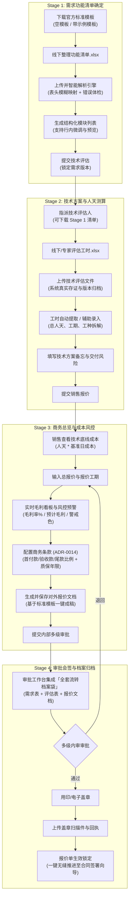

# ZK-HubX 报价「文件流转模式」全面优化设计方案

> **文档版本**：v1.0  
> **状态**：方案设计阶段（待评审确认，不包含业务代码变更）  
> **作者**：ZK-HubX 架构组 / 销售域设计组  
> **对齐架构资产**：[ADR-0012](adr/0012-quote-has-online-and-file-source-modes.md)、[ADR-0013](adr/0013-file-mode-is-file-plus-key-form.md)、[ADR-0014](adr/0014-file-mode-key-fields.md)、[ADR-0025](adr/0025-file-mode-parses-feature-list-into-pdf.md)

---

## 1. 业务背景与设计目标

### 1.1 为什么需要优化「文件流转模式」？
在企业级定制开发与数字化交付业务中，报价方案存在两类典型作业场景：
1. **在线数据流转模式（结构化在线协同）**：适合内部跨部门（销售、技术、UI、项目经理）在线协作，多端拆解、在线逐项填报人天与单价，全流程在线算税与毛利；
2. **文件流转模式（离线文件流转机制）**：
   - **客户自备清单**：客户通常会提供多达数十至上百行已有的 Excel 需求表；
   - **外部专家/外协团队填报**：企业往往需要将功能清单委派给外部兼职架构师、行业专家或供应商评估，外部人员无法或不便直接操作内部 CRM；
   - **高效率批量作业**：在大型复杂项目中，Excel 的快捷复制、公式计算与批量调整比在线表单更加高效；
   - **档案留存习惯**：财务、法务与高管在审批和审计时，习惯调阅带有版本归档属性的 Excel/PDF 原件。

### 1.2 现状痛点与业务断层分析
目前系统虽定义了 `flowMode: 'file'`，但在实际使用中存在 **5 大核心断层**：

| 阶段 | 现状实现与缺陷 | 业务影响与痛点 |
| :--- | :--- | :--- |
| **Stage 1 功能清单** | 仅有一个朴素的上传文件按钮；**没有官方标准 Excel 模板下载入口**；只支持严格的“五列”列名（模块/子功能/描述/备注/端），若客户表头略有差异直接报错。 | 销售与客户/技术沟通无标准模板可用，导入频繁报错，缺乏容错与解析体检。 |
| **Stage 2 技术评估** | 虽有“上传评估文件”，但**并未真实存储文件实体**（只读了文件名），无法二次下载；工时与人天只能靠技术手动输入两个孤立数字。 | 技术评估原件丢失，无法调阅核实；无法从评估表中自动抽取人天，纯人工敲数字易出错。 |
| **Stage 3 报价配置** | 销售仅能输入“报价工期”和“报价总额”一个粗暴的大数字；**完全缺失成本透视、毛利率测算、税率与付款批次配置**（偏离了 ADR-0014）。 | 销售纯凭感觉盲报，不知技术底线成本与利润空间；无法约定预付款/进度款/尾款比例，影响后续合同生成。 |
| **Stage 4 审批盖章** | 虽复用了审批状态机，但审批流中**无法一站式调阅该方案的全套流转文件袋**（原始需求.xlsx + 评估表.xlsx + 报价单.pdf）。 | 领导/审批人需在线下微信/邮件到处找附件，失去了文件流转集中管控的意义。 |
| **线索详情页联动** | 线索详情页方案卡片只展示价格工期，无法直接下载该版本关联的原始需求表与技术评估表。 | 销售与客户复盘谈判时，无法快捷取用文件，造成信息孤岛。 |

### 1.3 核心设计原则
1. **离线自由，系统有底**：允许外部与线下使用熟悉的 Excel 流转，但回传系统时必须形成结构化归档与成本闭环；
2. **文件为核，双向穿透**：原始 Excel 需求文件、技术评估文件、最终对外 PDF 报价单全程有档可查、可随时下载；
3. **商务严谨，底线透明**：文件流转模式在商业控制层面（毛利率、底线成本、付款批次）必须具备与在线模式等同的严肃性，拒绝纯盲填；
4. **极致易用，容错引导**：提供官方标准双模模板下载，支持智能模糊列名识别与上传前数据体检。

---

## 2. 总体架构与业务状态流转图



---

## 3. 四大作业阶段全景优化设计

### 3.1 Stage 1：功能清单上传与智能导入

#### 1. 官方标准 Excel 模板体系
在 Stage 1 界面显式提供标准模板下载，满足不同角色需求：
- **模板 A：空白标准模板（`ZKRT_功能清单标准模板_空白.xlsx`）**
  - 规范表头：`模块（必填）`、`子功能（必填）`、`功能描述（建议填）`、`备注说明（选填）`、`所属终端（Web/App/Pad/小程序）`；
  - 表头自带下拉校验（终端类型可下拉单选，防填错）。
- **模板 B：示范带数据模板（`ZKRT_功能清单标准模板_示例参考.xlsx`）**
  - 内置 3 个典型模块、8 个子功能的标准填充示范，标注格式规范。

#### 2. 智能表头模糊映射与容错解析引擎
不再机械要求表头文字 100% 严格一致，解析器内建智能别名词典：
- `模块` 别名：`一级模块`、`功能模块`、`模块名称`、`系统模块`
- `子功能` 别名：`二级功能`、`子功能名称`、`功能点`、`功能名称`
- `描述` 别名：`功能描述`、`需求描述`、`详细描述`、`业务说明`
- `备注` 别名：`说明`、`备注说明`、`技术备注`
- `端` 别名：`终端`、`适用终端`、`所属端`、`平台`

#### 3. 上传结果数据体检与预览看板
上传解析后，提供即时数据质量分析，避免带病提交：
- **体检统计**：共解析出 $M$ 个模块、$N$ 项二级功能，覆盖终端（如 PC端、移动端）；
- **异常诊断提示**：
  - ⚠️ 警告：检测到 2 个功能点未填写描述，是否继续？
  - ⚠️ 警告：检测到 1 个重名子功能，已自动去重合并；
- **在线轻量微调**：支持表格行内直接修改模块名或删除无用行，无需为了一个小错反复重新传文件；
- **反向导出**：支持把当前解析结果一键重新导出为干净的 Excel。

---

### 3.2 Stage 2：技术评估文件与工时测算

#### 1. 真实文件对象持久化与档案留存
- 解决原有仅保留文件名字符串的严重缺陷，建立完整的文件对象模型：
  ```typescript
  interface FileAttachmentEntry {
    id: string;
    name: string;
    size: number;
    url: string;
    uploadedAt: string;
    uploadedBy: string;
    version: number;
  }
  ```
- 支持**文件多版本沉淀与回溯**（如 `v1-工业巡检工时初估.xlsx`、`v2-工业巡检工时精修.xlsx`），界面提供一键预览与下载链接。

#### 2. 工时自动提取与双模式录入
- **智能提取**：若技术上传了包含标准汇总行的工时表，系统自动扫描并提取其中的“总计人天”与“建议交付工作日”，一键回填到表单；
- **辅助录入**：技术亦可直接在界面确认并修改：
  - **建议交付工期（工作日）**：用于衡量日历工期；
  - **总人天（Man-Days）**：用于测算总工作量；
  - **工种拆解（可选展开）**：支持简单勾选前端/后端/UI/测试各自人天，不强制要求逐项拆解（严格遵守 ADR-0025 不增加过重负担）。

#### 3. 技术方案备忘与交付风险说明
新增结构化富文本备忘输入：
- **核心技术选型建议**（如：离线缓存方案、微服务部署要求）；
- **交付前提与外部依赖**（如：需客户提供高精地图 API 接口密钥）；
- **潜在风险与不确定项**（作为销售对外谈判与把控边界的有力依据）。

---

### 3.3 Stage 3：商务总览、成本穿透与条款补齐（对齐 ADR-0014）

在文件流转模式中，销售虽然不必在线一条条功能配置工时，但**绝不能盲目报价**。系统应提供清晰的商业计算辅助与风控底线：

#### 1. 技术底线成本透视与实时毛利看板
- **技术基准成本计算**：
  $$\text{技术基准成本} = \text{总人天} \times \text{基准日成本（默认 600 元/天或自定义岗位日成本）}$$
- **销售总报价与交付工期输入**：
  - 销售输入期望的对外 `报价总额（元）` 与承诺给客户的 `商务工期（工作日）`；
- **实时毛利与健康度诊断**：
  $$\text{预计毛利额} = \text{报价总额} - \text{技术基准成本} - \text{差旅外协（如有）}$$
  $$\text{预计毛利率} = \frac{\text{预计毛利额}}{\text{报价总额}} \times 100\%$$
- **毛利三色预警机制**：
  - 🟢 **毛利率 $\ge 45\%$**：健康，符合公司标准利润模型；
  - 🟡 **$25\% \le \text{毛利率} < 45\%$**：关注，可能触发总监级审批节点；
  - 🔴 **毛利率 $< 25\%$**：警戒，强制提示“当前毛利率过低，审批可能被驳回，建议上调报价或优化工时”。

#### 2. 商业与付款条款补齐（ADR-0014 刚性要求）
补齐长期缺失的交易要素，为生成客户 PDF 与后续主合同打下坚实基础：
- **分期付款节点计划（Payment Terms）**：
  - 支持快捷预设模板：
    - `3/4/2/1 阶段付款`（预付 30% / 中期 40% / 终验 20% / 质保 10%）
    - `5/4/1 标准付款`（预付 50% / 终验 40% / 质保 10%）
    - `100% 验收后付`（国企/央企账期专用）
  - 支持销售自由调整各期比例与计划支付条件；
- **发票与税率设置**：专票（6% / 13%）、普票（不含税/含税）；
- **质保期**：默认 1 年免费运维质保；
- **报价有效期**：默认 30 天。

#### 3. 客户正式报价文档（OnlineDocument）同步生成
- 销售在工作台内点击“保存并生成报价文本”，系统将 Stage 1 解析的功能清单与 Stage 3 的商务条款自动拼装到标准模板中；
- 界面即时呈现标准排版预览，支持 Word / PDF 一键下载。

---

### 3.4 Stage 4：审批会签、盖章与全套文件袋归档

#### 1. 审批人「全套文件袋（Dossier）」统一穿透面板
在审批卡片上方，集中呈现该方案在文件流转中产生的所有物料，审批人点击即可随时调阅：
```
📦 本次报价全套附件档案（文件流转）：
  ├─ 📄 [客户需求清单_v1.0.xlsx] (148 KB · 上传人：张三销售 · 08-12 10:20) [下载] [预览]
  ├─ 🛠️ [技术工时评估意见书.xlsx] (210 KB · 评估人：罗总 · 08-12 14:00) [下载] [预览]
  ├─ 📑 [对外正式报价说明函.pdf] (520 KB · 系统自动生成 · 08-12 15:30) [下载]
  └─ 🔏 [客户签章确认件.pdf] (1.2 MB · 待回传)
```

#### 2. 用印审批与盖章回执归档
- 审批通过后，进入用印阶段，系统生成防伪水印版本；
- 销售完成线下协议盖章后，在附件栏上传清晰的扫描件（PDF/图片）；
- 状态推进为 `confirmed`（已确认报价）。

#### 3. 无缝推入合同签署向导（ADR-0001 对齐）
- 报价确认后，点击“生成合同”，向导直接继承文件流转已设定的项目名、总金额、付款批次、质保年限；
- **零重复输入**，彻底杜绝数据二次手敲造成的合同金额错误。

---

## 4. 数据模型与接口演进设计 (Data Schema)

在 `Quote` 实体中增强 `fileFlow` 专有结构（向下兼容既有数据）：

```typescript
export interface FileFlowAttachment {
  id: string;
  name: string;
  size?: number;
  url: string;
  uploadedAt: string;
  uploadedBy?: string;
}

export interface QuoteFileFlow {
  /** 1. 需求功能清单原始文件 */
  featureListFile?: FileFlowAttachment;

  /** 2. 技术评估原始文件 */
  evaluationFile?: FileFlowAttachment;
  /** 历史技术评估文件版本链 */
  evaluationFileHistory?: FileFlowAttachment[];
  /** 建议交付工期（工作日） */
  evaluationWorkDays?: number;
  /** 评估总人天 */
  evaluationTotalDays?: number;
  /** 各工种人天拆解（可选） */
  evaluationRoleDays?: Record<string, number>;
  /** 技术评估备忘与技术风险提示 */
  techSolutionNote?: string;

  /** 3. 销售报价与商业条款 (ADR-0014) */
  quoteWorkDays?: number;
  quoteAmount?: number;
  /** 测算出的预计毛利率 (0~1) */
  calculatedMarginRate?: number;
  /** 付款分期计划 */
  paymentTerms?: Array<{
    name: string;
    percentage: number;
    amount: number;
    condition: string;
  }>;
  /** 质保年数 */
  warrantyYears?: number;
  /** 发票类型 */
  invoiceType?: '专票' | '普票';
  /** 报价有效期（天） */
  validityDays?: number;

  /** 4. 在线文档与终稿 */
  onlineDocument: {
    status: 'empty' | 'draft' | 'saved' | 'finalized';
    savedAt?: string;
    content?: string;
  };

  /** 5. 最终盖章扫描件回执 */
  scans: FileFlowAttachment[];
}
```

---

## 5. UI/UX 视觉与交互体验优化方案

1. **界面色调与质感**：
   - 文件流转模式采用专属的 **轻奢紫（Purple）与科技蓝（ArcoBlue）** 搭配，显著区分于在线模式，给用户明确的心智指引；
2. **流程步进指引**：
   - 顶部步进条沿用 `上传功能清单 -> 技术评估文件 -> 报价文档确认 -> 系统审批盖章`；
   - 步骤卡片右侧增加当前阶段核心负责人徽章（如 `Stage 1: 销售上传`、`Stage 2: 架构师评估`、`Stage 3: 商务经理定价`）；
3. **沉浸式双栏工作区**：
   - 左侧主区域：操作表单、Excel 预览与文件上传拖拽区；
   - 右侧辅助区域：**全生命周期文件袋面板** + **动态毛利/成本小计卡片**，随用户修改实时浮动响应。

---

## 6. 分步演进与实施路线图 (Roadmap)

本优化建议分为 **3 个敏捷迭代阶段** 稳步落地，确保零回归破坏：

```
[Phase 1] 基础夯实：模板体系与 Stage 1 智能清单解析升级
    ├── 1. 编写官方 Excel 导出逻辑（包含空白模板与带示例模板）
    ├── 2. 升级 FeatureListUpload 组件（增加模板下载、表头别名映射与错误体检）
    └── 3. 补齐 Stage 1 单元测试

[Phase 2] 核心能力：Stage 2 文件存证 + Stage 3 商务毛利与付款配置
    ├── 1. 改造技术评估文件上传（实现真实文件对象留存与下载链接）
    ├── 2. 补齐 Stage 3 商务毛利看板、付款批次配置与发票质保设置 (ADR-0014)
    └── 3. 对齐 computeAmountBreakdown 联动计算

[Phase 3] 闭环成型：全套文件袋面板 + 线索详情页穿透联动
    ├── 1. 打造 Stage 4 审批界面「全套流转文件袋」穿透组件
    ├── 2. 在线索详情页 LeadQuotationManager 中提供原件快速下载
    └── 3. 全量单测覆盖与生产构建冒烟测试
```

---

## 7. 方案决策与下一步指引

请您审阅上述优化设计方案。
- **若您对方案有增减或微调意见**（例如字段名称、付款预设模板、毛利预警阈值），我们可以针对具体环节进一步深化；
- **若您认可本方案**，我们下一步即可按照 Phase 1 启动第一阶段（标准模板生成与智能清单解析升级）的代码编写与单测推进。
