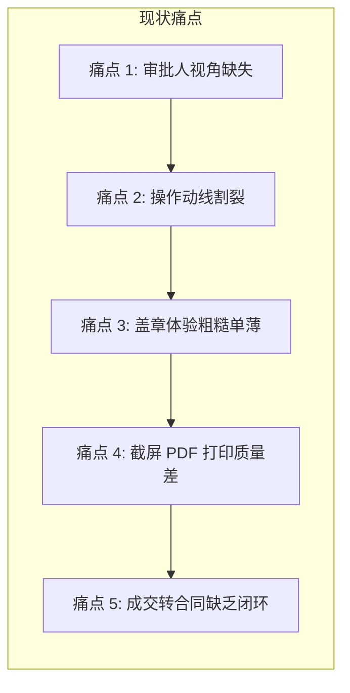

# 系统审批与盖章页面（Stage 4）UI/UX 深度优化方案

> **文件归属**：`HubX/docs/系统审批与盖章页面UI-UX深度优化方案.md`  
> **涉及核心组件**：  
> - 主工作台：[`Stage4Approval.tsx`](file:///Users/pc/Documents/AI%20work/01-PROJECTS/ZK%20HubX/ZK_HubX/ZK_HubX/HubX/packages/ui/src/app/pages/quotation/stages/Stage4Approval.tsx)  
> - 审批流程控制面板：[`QuotationWorkbench.tsx`](file:///Users/pc/Documents/AI%20work/01-PROJECTS/ZK%20HubX/ZK_HubX/ZK_HubX/HubX/packages/ui/src/app/pages/quotation/QuotationWorkbench.tsx) (`ApprovalProcessPanel`)  
> - 报价流转与权限内核：`quoteFlow.ts`, `quoteAuditSnapshot.ts`, `quoteDocumentTemplate.ts`, `quotePdfTemplate.ts`  
> **文档版本**：v1.0 (2026-09-07)  

---

## 一、现状审查与核心痛点剖析

当前「系统审批与盖章」位于报价工作台的 Stage 4（以及文件流转的对应阶段）。经过对现有代码、交互动线与角色职责的全面审查，发现以下五大深层次痛点：



### 1. 审批人视角缺失：信息冗长无重点，缺乏决策关键指标
- **现状**：审批人（销售总监、技术负责人、财务总监、总经理）进入 Stage 4 时，看到的仍是原始冗长的功能清单三级表、原始工时、增项表格。审批人需要滑动数屏才能找到关键信息。
- **痛点**：审批人核心关注的是**经营合规与财务风控**——「毛利率是否达标？」、「技术评估有无高风险子项？」、「垫资代采是否合规？」、「商务账期是否过长？」。现有界面缺乏直击决策核心的**审批风控体检卡**。

### 2. 交互动线严重割裂：审批操作藏在侧边栏，销售操作在中央
- **现状**：
  - 审批人会签的「同意并通过」、「驳回报价」、意见输入框，以及盖章人的「确认盖章」被塞在右侧狭窄（宽 280px）的侧边栏 `ApprovalProcessPanel` 中；
  - 而销售人员的「发送客户」、「确认成交」、「退回改清单」、「生成合同」却堆在中央工作区底部。
- **痛点**：审批人进入工作台后，视觉焦点在中央的大卡片，很难第一时间注意到右侧栏底部的操作按钮；侧边栏空间局促，填写长篇驳回意见体验不佳。

### 3. 印章与签署体验单薄：红框文字伪印章，缺少多实体与防伪机制
- **现状**：当前盖章只是在右上角用 CSS 旋转 -20 度画了一个粗糙的文字红框（`中科集团公章`）；
- **痛点**：
  - 无法根据报价签约主体（中科智汇 / 中科融创等）选用对应的企业公章或合同章；
  - 缺乏防伪印章编码（如统一信用代码/印章序列号）、防伪验真二维码与骑缝章效果；
  - 线下盖章扫描件上传缺乏多页高保真缩略图、旋转纠偏与全屏对比能力。

### 4. 报价单导出引擎落后：Canvas 截屏模糊跨页截断
- **现状**：目前通过 `html2canvas` 截图转 PDF，存在三大硬伤：
  - 文字全部变成低分辨率位图，不可选、不可复制；
  - 长表格跨页时文字被从中间横切截断；
  - 样式与 Stage 3 的正式中科红头商务模板完全脱节。
- **痛点**：审批人无法在审批时直观看到**外发给客户的标准纸质 A4 公函长什么样**。

### 5. 版本变更对比与重审追踪断层
- **现状**：系统已有 `quoteDiff.ts`（差异比对算法），但在 Stage 4 界面中完全没有呈现。
- **痛点**：当销售因为被驳回而修改了价格、删减了功能、调整了付款账期再次发起审批时，审批人不知道到底改了哪一项，必须肉眼对比，极度低效。

---

## 二、重构设计理念：企业级「审批决策驾驶舱 + A4 纸张级文档签章」

针对上述痛点，提出**「1 个决策顶栏 + 2 大视图（决策摘要 / 正式公文）+ 1 套真印章签署引擎」**的重构体系：

```
┌─────────────────────────────────────────────────────────────────────────────┐
│ 顶部：审批与流转指挥中心 (Approval Command Bar)                               │
│ 阶段状态 Tag | 三人并行会签进度 (头像/时间/评语) | 审批/盖章/外发主快捷操作区 │
├───────────────────────────────────────────────────────┬─────────────────────┤
│ 主工作区 (支持 Tab 自由切换)：                         │ 右侧：商务风控驾驶舱 │
│                                                       │                     │
│ [Tab 1: 正式公函与电子签章 (A4 纸张纸质视图)]           │ 💰 总报价: ¥128,000 │
│  - 中科红头企业标准报价单样式 (完美分页)               │ 📈 预估毛利率: 42.5%│
│  - 落款处多主体公章/合同章/电子签名 (带防伪编码)      │ ⏱️ 总工期: 35 工作日 │
│  - 真实印章拖拽对齐 / 盖章扫描件对比                   │ 🛡️ 风控规则体检 100% │
│                                                       │                     │
│ [Tab 2: 审批风控与版本变更对比 (Diff 决策视图)]       │ ─────────────────── │
│  - 相比上一版本变动高亮 (总价/模块/账期/成本)         │ 📋 签约主体与发票   │
│  - 高风险技术点与垫资代采特别披露                      │ 增值税专票 6%       │
│  - 商务条款 (回款条件/预计日期/违约责任) 快速审查     │ 中科智汇科技有限公司 │
└───────────────────────────────────────────────────────┴─────────────────────┘
```

---

## 三、五大核心模块升级规划

### 模块 1：顶部流转指挥中心（Approval Command Bar）
- **会签节点可视化进程条**：
  - 线性展示：`销售提交 -> [销售主管 黄奕] -> [技术总监 罗总] -> [财务/决策人 闵总] -> [印章管理员] -> 发送客户 -> 确认成交`；
  - 节点状态以不同色彩区分：已同意（绿色徽章 + 审批时间 + 评语 Tooltip）、待处理（脉冲高亮当前审批人）、已驳回（红色警示 + 驳回理由展开）；
- **主决策操作吸顶栏**：
  - 识别当前登录人是否为待审批人。若是，直接在顶栏呈现：
    - `同意并通过`（支持选择常用快捷审批意见，如「数据核验无误，同意报价」）；
    - `驳回修改`（弹窗选择退回节点：退回销售改清单 / 退回技术重估，必填驳回说明）；
  - 若为印章管理员，直接呈现 `加盖企业公章` 操作入口；
  - 若为销售，呈现 `外发客户登记` / `确认成交` / `生成正式合同`。

---

### 模块 2：A4 纸张级正式公函与高保真签章（Paper Document Viewer）
- **放弃 Canvas 截屏，接入正式矢量公文渲染器**：
  - 复用已验证的 `generateQuoteHtml`，将报价单呈现为一张拥有精致阴影与页边距的标准 **A4 纸质公函**（背景仿白卡纸微质感）；
  - 支持多套专业版式自由预览切换（标准红头版、极简商务版、明细清单版）；
  - 打印与导出直接调用浏览器原生高质量矢量 Print/PDF 生成引擎，保证导出 PDF 文字可选、高清无失真、分页不截断。
- **真实电子印章（E-Stamping Engine）**：
  - 根据 `quote.signingEntity` 自动绑定对应主体印章：
    - `zkrt` -> 北京中科智汇科技有限公司
    - `zkrc` -> 深圳中科融创技术有限公司
  - 印章设计符合国家电子印章规范：
    - 正圆形朱红印鉴、五角星徽章、环形中文主体名称；
    - 印章防伪横排编码（如 `★ 1101080098762`）；
    - 右下角配备该报价单专属的防伪验真编号与时间戳。
- **盖章模式双轨无缝切换**：
  1. **系统电子印章**：点击盖章后，带有逼真朱红色印泥质感印章落于公函右下角，附带印章管理员数字签名；
  2. **线下物理盖章扫描件**：支持上传客户盖章件或我方盖章纸质扫描件，提供左侧扫描件、右侧系统数据并排对比核对功能（Dual-Pane Compare）。

---

### 模块 3：审批人专用「风控与版本变更 Diff 驾驶舱」
- **审批风控体检雷达（Compliance Check Radar）**：
  - **毛利率健康度**：计算 `(总报价 - 总技术与商务成本) / 总报价`，低于公司底线（35%）自动标红预警，列出折让原因；
  - **人天与工期核验**：前端、后端、测试总人天及单价是否超出行业基准；
  - **资金安全与垫资排查**：外部代采（如云资源、短信、第三方接口）是否客户直购？我方代采金额有无垫资上限限制？
  - **回款条件合规度**：预付款比例是否 < 30%？回款条件是否包含明确的工作日时限？
- **版本变更对比面板（Version Diff Timeline）**：
  - 自动调用 `computeQuoteDiff(previousQuote, currentQuote)`；
  - 直观呈现：
    - 🔴 删减功能：哪些子功能被剔除？减少工时多少？
    - 🟢 新增功能：客户追加了哪些需求？
    - 🟡 成本与价格变动：总报价由 `¥150,000` 调优至 `¥128,000`（降幅 -14.6%）；
    - 🔵 商务条款变更：付款期由 3 期改为 4 期，尾款质保期延长至 2 年。

---

### 模块 4：成交转合同与商业全链路闭环（Deal to Contract Bridge）
- **成交战报卡片（Deal Milestone Banner）**：
  - 报价单确认成交后，呈现商业成果战报（项目总额、签约客户、预计开工周期、负责销售）；
- **合同生成无缝预填（Deal-to-Contract Prefill Engine）**：
  - 点击「生成主合同」或「生成补充合同」，系统自动打通 `dealQuotePrefill.ts`：
    - 自动提取：合同名称、甲乙方签约主体、合同金额、付款期数、里程碑回款条件、技术需求清单（SOW）、出差驻场违约责任；
    - 秒级跳转合同向导 `/contracts/new`，直接完成 90% 合同条款预填，杜绝销售手工搬运数据出错。
- **电子签署全流程演示包（E-Signing Package）**：
  - 支持直接生成法大大 / 腾讯电子签格式的签署预备包，记录签署哈希码与时间戳。

---

### 模块 5：完备的逆向流转与容错机制（Reversible State Machine）
- **退回盖章（Return to Stamp）**：已盖章但未发客户前，若发现印章有误，销售或管理员可一键回退到「待盖章」；
- **撤回发出（Withdraw Sent）**：已发送客户但客户提出异议需微调时，可撤回重签；
- **退回改清单（Return to Edit Features）**：会签驳回后，销售一键退回草稿阶段重新调整功能点与报价；
- **作废与历史存档（Void & Archive）**：客户放弃项目时记录作废原因，保留全生命周期不可篡改快照。

---

## 四、UI 视觉与交互重构规范（对齐 ui-refactor 规范）

1. **色彩与质感**：
   - A4 纸张公函：背景 `#ffffff`，轻微拟真阴影 `box-shadow: 0 4px 20px rgba(0,0,0,0.08)`，模拟专业高档公文质感；
   - 电子印章：专属印泥朱红色 `rgb(220, 38, 38)`，配合 0.85 不透明度与微倾斜随机角度（-8° ~ -15°），还原真实盖章观感；
   - 审批节点：已通过（Emerald 绿）、待审批（Amber 橙）、已驳回（Crimson 红）；
2. **信息密度与无缝切换**：
   - 默认提供顶层分段控制器（Segmented / Tabs）：
     - `📄 正式公函与印章`（默认视角，供销售发客户、盖章人盖章、下载标准 PDF）
     - `🔍 审批风控与版本对比`（供总监与财务审核决策）
     - `📊 评估与成本明细`（供技术主管深入查阅底表）
3. **响应式与操作友好**：
   - 无论窗口大小，顶部指挥栏始终清晰指示当前身份与可执行操作；
   - 驳回或作废时采用居中模态对话框，提供充足的理由输入空间与退回节点单选。

---

## 五、落地实施步骤规划

| 阶段 | 实施任务 | 关键产出物 |
| :--- | :--- | :--- |
| **阶段 1：顶层架构与数据流对齐** | 重构 `Stage4Approval.tsx` 布局结构，将审批盖章动作整合至主流程 | 统一的 Approval Command Bar 顶栏与身份识别 |
| **阶段 2：高保真 A4 纸质公函与电子印章** | 嵌入 `generateQuoteHtml` A4 预览卡片，制作企业级电子印章组件与防伪编号 | 矢量级 A4 文档预览、电子公章、防伪二维码 |
| **阶段 3：风控体检与版本 Diff 对比** | 接入 `computeQuoteDiff` 与毛利率风控卡，呈现审批人专属决策仪表盘 | 审批人决策 Tab：毛利预警、条款核验、版本改动 Diff |
| **阶段 4：成交转合同与全链路闭环** | 升级成交后的引导卡，完善合同向导参数预填与电子签署状态同步 | 成交战报、合同向导直通车、流转轨迹全景 |
| **阶段 5：测试套件与构建验证** | 编写 `Stage4Approval.test.tsx` 单元测试，运行全量单测与 `npm run build` | 100% 测试通过率，零构建报错 |
